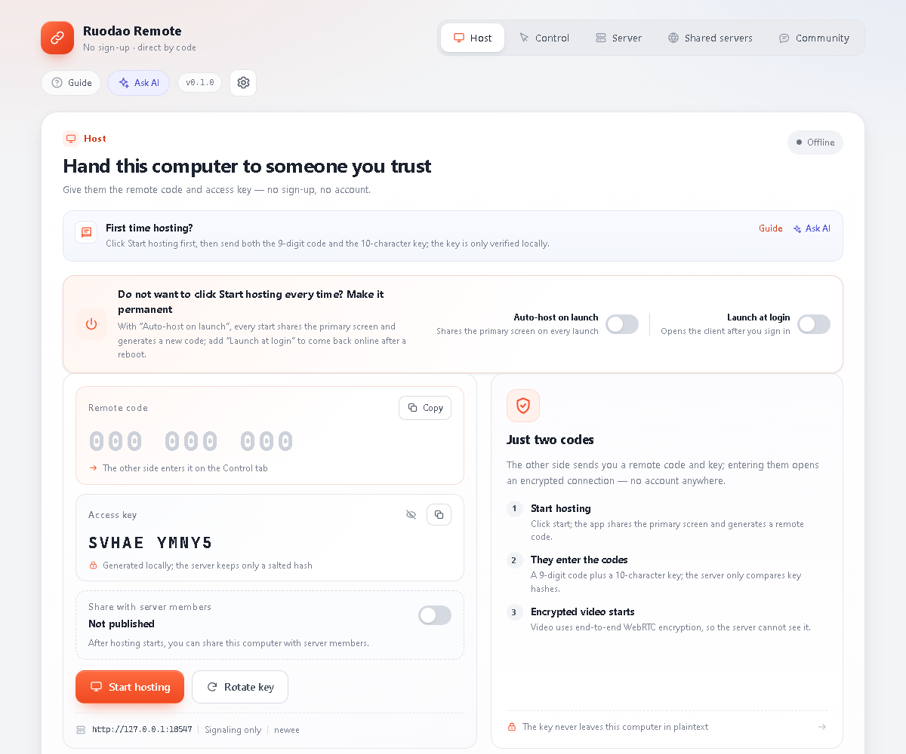
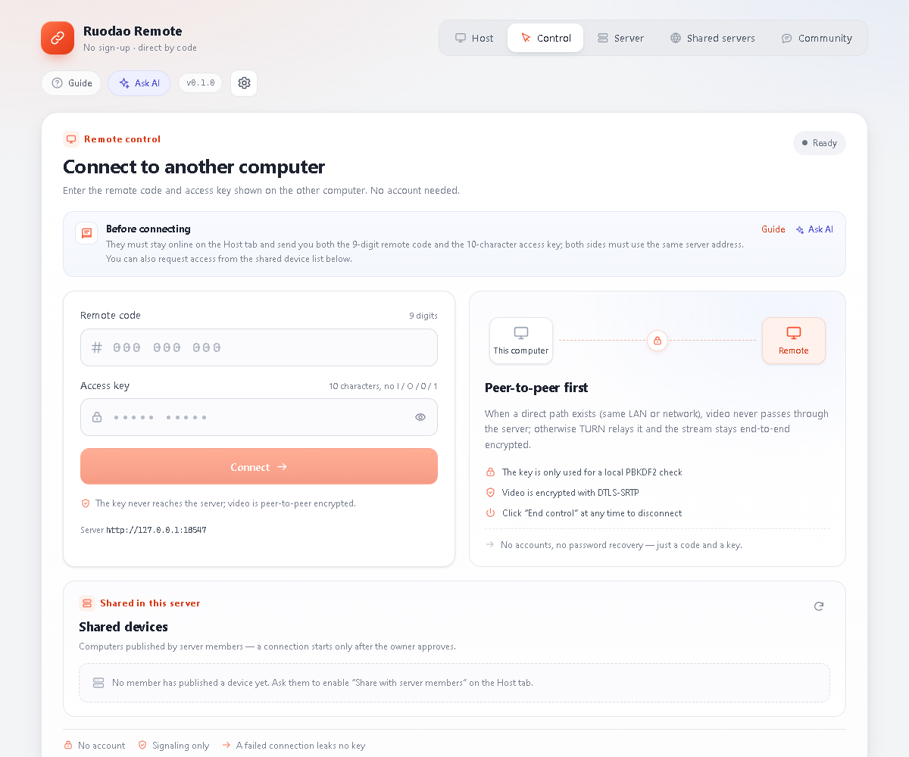
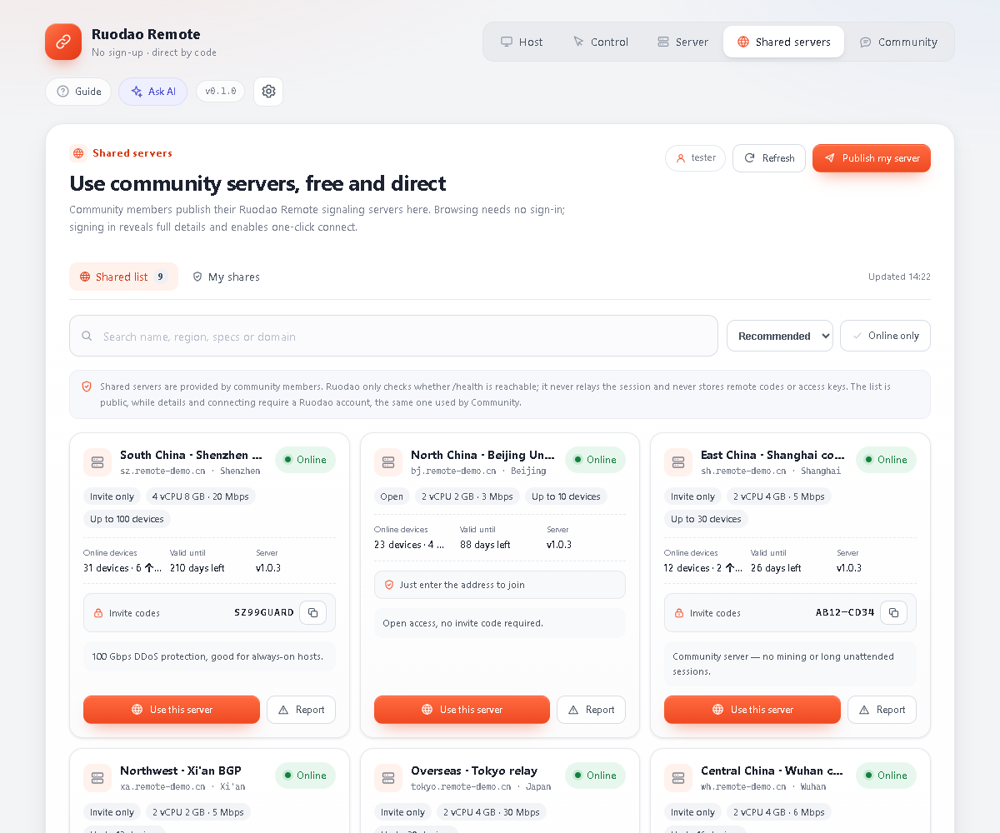
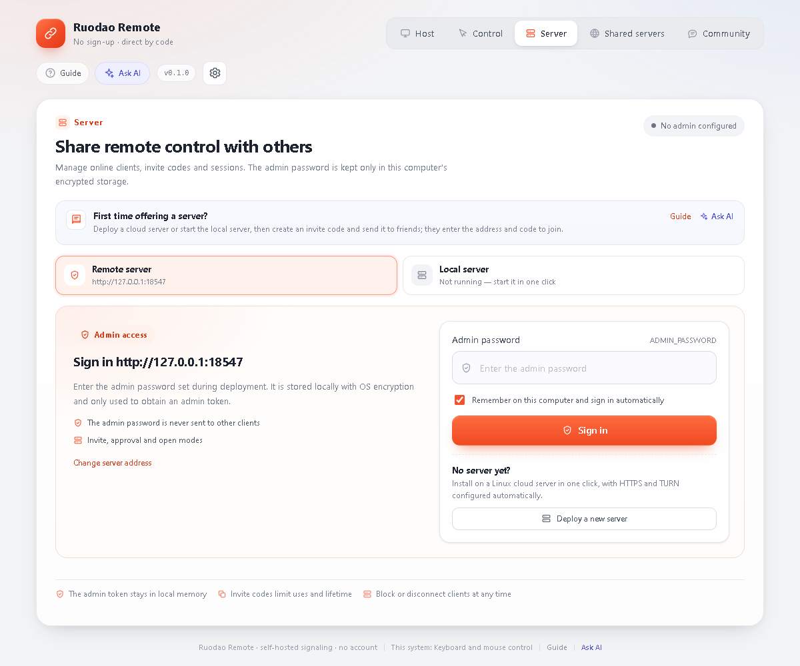
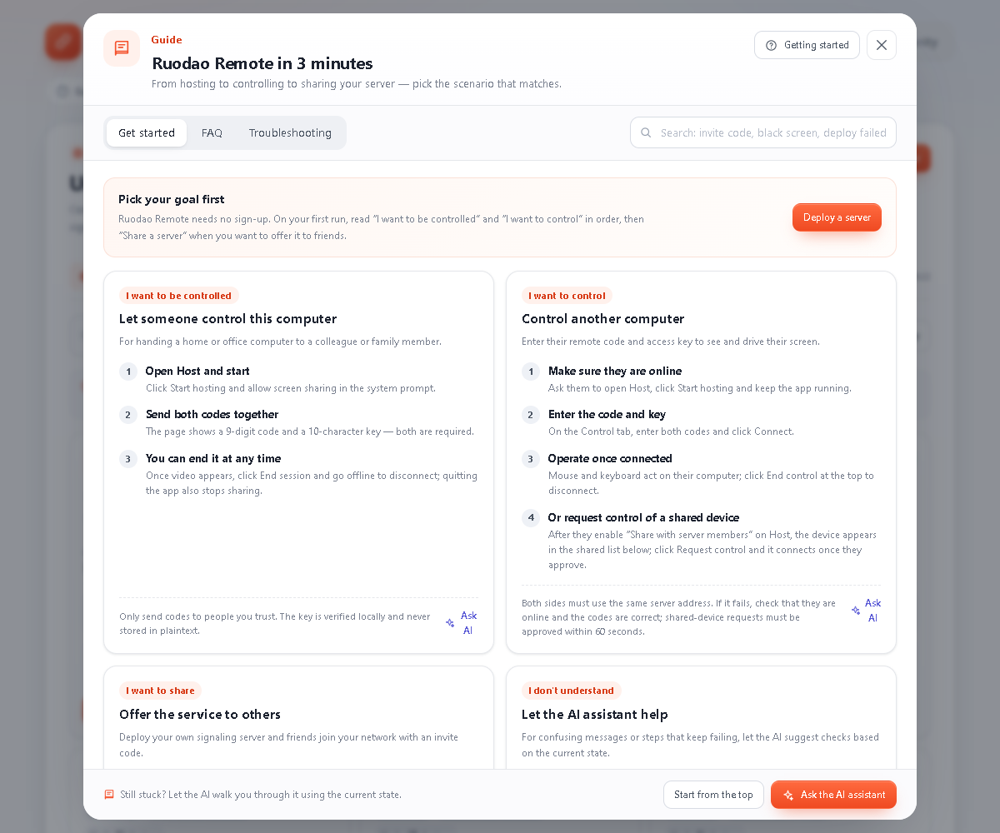
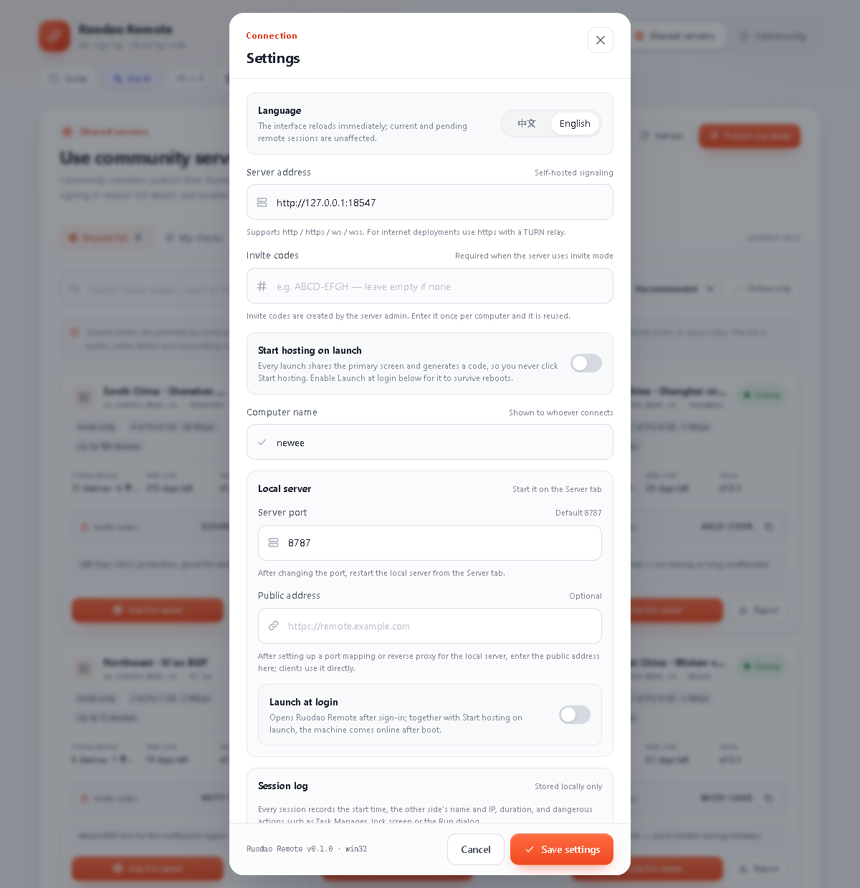

# Ruodao Remote

**Account-free remote desktop for Windows.** The host starts a session and gets a 9-digit remote code plus a 10-character access key; the controller types both to connect. Screen and input travel peer-to-peer over WebRTC with DTLS-SRTP encryption — the server only handles signaling, device management and TURN credentials.

[简体中文](README.md) · [**English**](README.en.md)

[](https://github.com/ruodaoai/ruodao-remote/releases/latest)
[](LICENSE)
[](#requirements-and-known-limitations)
[](https://github.com/ruodaoai/ruodao-remote/actions/workflows/ci.yml)

[**Download for Windows**](https://github.com/ruodaoai/ruodao-remote/releases/latest) ·
[**Download for macOS**](https://github.com/ruodaoai/ruodao-remote/releases/latest) ·
[Server bundle](https://github.com/ruodaoai/ruodao-remote/releases/latest/download/ruodao-remote-server.zip) ·
[Quick start](docs/en/quick-start.md) ·
[Server deployment](docs/en/server-deployment.md) ·
[FAQ](docs/en/faq.md)

<p align="center">
  
</p>

## Why Ruodao Remote

| | |
| --- | --- |
| **No account needed** | No sign-up, no e-mail verification, no device binding to a cloud. Two codes are enough for one session. |
| **End-to-end encrypted** | Screen and input use WebRTC with DTLS-SRTP. The signaling server only sees device names, platforms and connection metadata — never pixels or keystrokes. |
| **Your own server** | Signaling, device approval, invite codes and audit logs live on your machine. Use the built-in Windows server on a LAN, or deploy to a Linux box in one click from the client. |
| **Collaboration built in** | In-session chat, on-demand clipboard sync, quality and zoom presets, pause input at any time. Share a device with members of the same server and approve each request. |
| **Shared server directory** | The *Shared servers* tab lists community-published signaling servers, sorted by availability, latency and expiry; one click writes the address and invite code into your local settings. You can also publish your own server, update it, take it down or report a broken one. |
| **English and Chinese UI** | The interface ships in Simplified Chinese and English, switchable under *Settings → Language*; the first launch follows the system locale. Labels, the built-in guide, errors and notices are translated together. |
| **Help when things break** | Scenario-based guide, diagnostics driven by the current state, and an optional AI assistant (after signing in with a Ruodao account, screenshots supported). |
| **Ruodao community** | The built-in *Community* tab follows Ruodao's open-source integration standard: product interaction numbers (comments, likes, version, last update) plus the comment stream, in sync with ruodao.com/open-source/ruodao-remote. A comment posted here is the same record shown on the site, and the session is shared with the shared server directory. |
| **Maintained over time** | Both the client and the Linux server check the Ruodao release API; every package is verified with SHA-256. The client downloads automatically and installs on exit; the deployed server uses a systemd timer that updates while idle and rolls back on failure. |

## Screenshots

<table>
  <tr>
    <td width="50%"><br><sub><b>Connect to another machine</b>: enter the 9-digit code and 10-character key — no account required.</sub></td>
    <td width="50%"><br><sub><b>Shared servers</b>: community signaling servers with address and invite code unlocked after sign-in.</sub></td>
  </tr>
  <tr>
    <td width="50%"><br><sub><b>Server management</b>: sign in to your own signaling server and manage devices, invite codes, sessions and audit logs.</sub></td>
    <td width="50%"><br><sub><b>Built-in guide</b>: step-by-step scenarios, diagnostics and the AI assistant.</sub></td>
  </tr>
  <tr>
    <td colspan="2"><br><sub><b>Settings</b>: server URL, invite code, launch at login, clipboard and auto-update in one dialog.</sub></td>
  </tr>
</table>

## Quick start in 3 minutes

### 1. Download and install

Grab `RuodaoRemote-Setup-<version>.exe` from [Releases](https://github.com/ruodaoai/ruodao-remote/releases/latest) and run it. The installer is not code-signed yet, so Windows SmartScreen shows "Unknown publisher" — choose *More info → Run anyway*. Some antivirus products may flag it heuristically; add an exclusion or use the installer build only.

On macOS grab `RuodaoRemote-<version>-arm64.dmg` (Apple Silicon) or `-x64.dmg` (Intel), open it and drag the app into *Applications*. The DMG is unsigned, so the first launch needs a right-click → *Open*.

### 2. Host: start a session

Open the client on the *Host* tab and click **Start hosting**. The page shows:

- a **9-digit remote code**, e.g. `174 840 397`;
- a **10-character access key**, e.g. `VJ9J5 Q2DXY`.

Send both to the other person over a trusted channel. For unattended hosts, enable *Auto-host on launch* and *Launch at login*.

### 3. Controller: connect

On the other computer, open the same client, switch to *Control remote device*, enter the same server URL plus the code and key, then click **Connect**. The host shows "Being controlled" and the controller gets the screen and input.

> The default server URL is `http://127.0.0.1:8787`, which only works on the same machine. To connect two computers you need a signaling server (next section) or a community server from the *Shared servers* tab.

## Shared servers

The *Shared servers* tab is a community directory served by the Ruodao cloud API. The client only displays entries and applies settings — it never proxies the session:

- **Directory**: name, region, specs, online status, device limit, server version and expiry, with search, sorting (recommended / latency / expiring soon) and an online-only filter. Offline or expired entries cannot be used.
- **Unlocked after sign-in**: anonymous visitors see redacted cards and a sign-in prompt. The session is shared with the *Community* tab. Server address and invite code appear only after signing in.
- **Use in one click**: *Use this server* writes the address and invite code into local settings and jumps to the controller page.
- **My shares**: publish your own server (name, address, region, specs, device limit, invite code, notes), then update or take it down.
- **Report**: report a broken or abusive entry; it is hidden locally right away and queued for review.

> A shared server is just a publicly listed signaling server. Screen content still flows only between the two peers — the server owner cannot see it.

## Self-hosting

The remote session never depends on a Ruodao account. You only need a reachable server to relay signaling.

### Option A — deploy from the client (recommended)

*Server* tab → **Deploy a new server**. Enter the Linux host, SSH port and credentials (password or private key), pick a registration mode, and the client will:

- install or reuse Node.js and Caddy;
- write a dedicated systemd unit and Caddy site without touching existing sites;
- optionally install coturn, generate a TURN secret and wire it up;
- install a system-level update timer (hourly check, install while no session is active, roll back on failed health check);
- open the required ports in ufw / firewalld;
- run a health check and write the server URL and admin password back into the client.

Targets Ubuntu 22.04+ / Debian 12+ (x86_64 or arm64). See [Server deployment](docs/en/server-deployment.md) for prerequisites and details.

### Option B — manual install from the bundle

```bash
# on the Linux server, as root
curl -LO https://github.com/ruodaoai/ruodao-remote/releases/latest/download/ruodao-remote-server.zip
unzip ruodao-remote-server.zip -d ruodao-remote-server
cd ruodao-remote-server
sudo bash install.sh
```

The script creates a `ruodao` service account, installs to `/opt/ruodao`, generates an admin password into `/etc/ruodao-remote.env` and starts the `ruodao-remote` systemd unit. It listens on `8787`; put an HTTPS reverse proxy in front for public use (Caddy / Nginx examples in the docs). Re-running the script upgrades in place and keeps devices, invite codes and audit logs. Manual installs do not add the auto-update timer — run the client's one-click deploy against the same host if you want it.

## Security model

- **The access key never reaches the server.** It is generated locally; the server stores a 16-byte random salt plus a PBKDF2-SHA256 hash (210,000 iterations) and compares with `timingSafeEqual`.
- **Transport encryption.** Screen and input use WebRTC with DTLS-SRTP; TURN only relays already-encrypted traffic.
- **The server only signals.** It sees device names, platforms, IPs and session metadata — not pixels, input events or plaintext keys.
- **Admin surface.** Admin passwords are verified with scrypt; sessions are HMAC-signed HttpOnly cookies or short-lived bearer tokens. Repeated failures lock by IP and globally.
- **Update verification.** Packages must come from `ruodao.com` or a subdomain and must provide a SHA-256 digest; a mismatch aborts the install.

Full boundaries and limitations: [Technical reference](docs/en/technical-reference.md) and [SECURITY.md](SECURITY.md).

## Requirements and known limitations

- Client: Windows 10 / 11 x64, or macOS 12+ (Intel / Apple Silicon). The macOS build currently works as a controller only.
- Input injection uses Win32 `SendInput`, so the host must be Windows.
- Server: Linux with systemd (Ubuntu 22.04+ / Debian 12+ preferred), or the built-in Windows server for LAN use.
- Only the primary display is captured; no multi-monitor switching, `Ctrl+Alt+Del`, UAC secure desktop or lock screen.
- Clipboard sync is plain text only (64 KB per item), off by default, and must be enabled on both sides.
- The installer is unsigned; use a code-signing certificate before public distribution.
- The key carries roughly 50 bits of entropy — share it over a trusted channel and rotate it after use.

## Documentation

| English | 中文 | Contents |
| --- | --- | --- |
| [Quick start](docs/en/quick-start.md) | [快速开始](docs/快速开始.md) | Install, host, control, in-session tools, first troubleshooting |
| [Server deployment](docs/en/server-deployment.md) | [服务端部署](docs/服务端部署.md) | One-click deploy, manual install, HTTPS, TURN, admin console |
| [FAQ](docs/en/faq.md) | [常见问题](docs/常见问题.md) | SmartScreen, firewalls, NAT, failed connections, failed updates |
| [Updates & releases](docs/en/updates-and-releases.md) | [更新与发布](docs/更新与发布.md) | Versioning, manifest contract, release flow, update settings |
| [Technical reference](docs/en/technical-reference.md) | [技术文档](docs/技术文档.md) | Environment variables, protocol, security boundaries, verification |
| [Contributing](docs/en/contributing.md) | [贡献指南](CONTRIBUTING.md) | Dev setup, branches, commit style, PR checklist |

## Build from source

Node.js 20+ (development uses Node 24).

```bash
# server
cd server
npm install
npm run build
npm start                 # 0.0.0.0:8787

# client (dev mode)
cd client
npm install
npm run dev

# Windows installer
cd client
npm run dist:win
```

Verify:

```bash
cd server && npm test && npm run typecheck && npm run build
cd client && npm test && npm run typecheck && npm run build
```

`npm run smoke` in `client` launches two real Electron windows and exercises the WebRTC connection, input injection, session chat and clipboard gating. It needs an interactive desktop session and briefly takes over the mouse.

## Repository layout

```
ruodao-remote/
├─ client/           Electron + React desktop client (Windows x64)
│  ├─ electron/      main process: signaling, sessions, sharing, deploy, updates, community
│  ├─ src/           renderer: pages, components, hooks, styles
│  └─ scripts/       build, screenshots, update manifest, smoke
├─ server/           Node.js + TypeScript signaling server (with /admin console)
├─ docs/             tutorials, deployment, release notes, screenshots (docs/en for English)
├─ packaging/server/ deployment scripts and systemd template
└─ .github/          CI, issue and PR templates
```

## Versions and updates

- `version.json` at the repository root is the single source of truth; the build fails if client and server versions diverge. Bump with `node scripts/set-version.mjs 0.2.0`.
- Packaged clients check the Ruodao update feed on launch, download by default and install on exit; you can also click the version badge to check and install manually.
- One-click deployments install `ruodao-remote-update.timer`: hourly checks, install and restart while idle, rollback when the health check fails.
- Release flow, manifest format and every update variable: [Updates & releases](docs/en/updates-and-releases.md).

## Feedback and contributions

- Check the [FAQ](docs/en/faq.md) and the in-app guide first. If that does not help, open an [issue](https://github.com/ruodaoai/ruodao-remote/issues) with the client version, server type (local / public), the exact error and reproduction steps.
- **Never paste remote codes, access keys, admin passwords or SSH private keys into an issue.**
- Read [CONTRIBUTING.md](CONTRIBUTING.md) (English version: [docs/en/contributing.md](docs/en/contributing.md)) before sending code.

## License

Released under the [MIT License](LICENSE). Use, modify and redistribute freely while keeping the copyright notice and license text; the software is provided "as is", without warranty of any kind.
