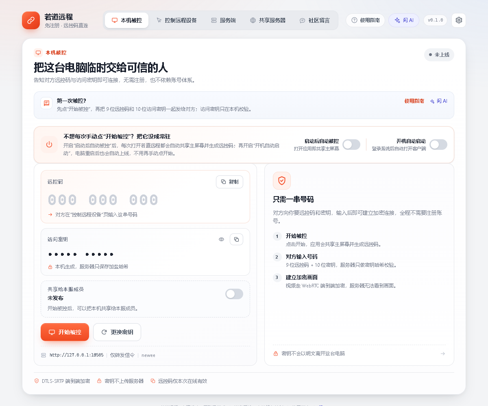
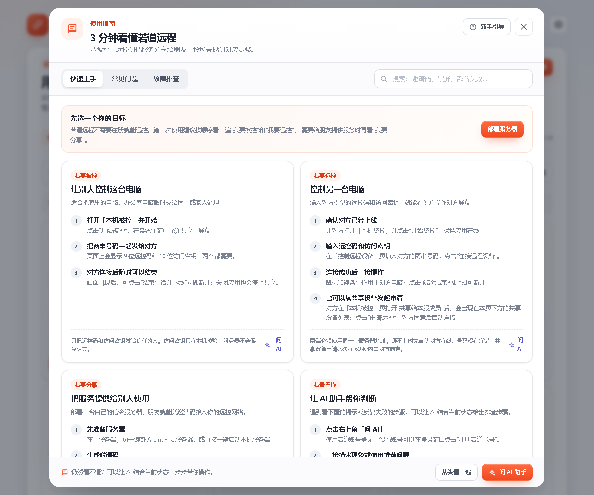
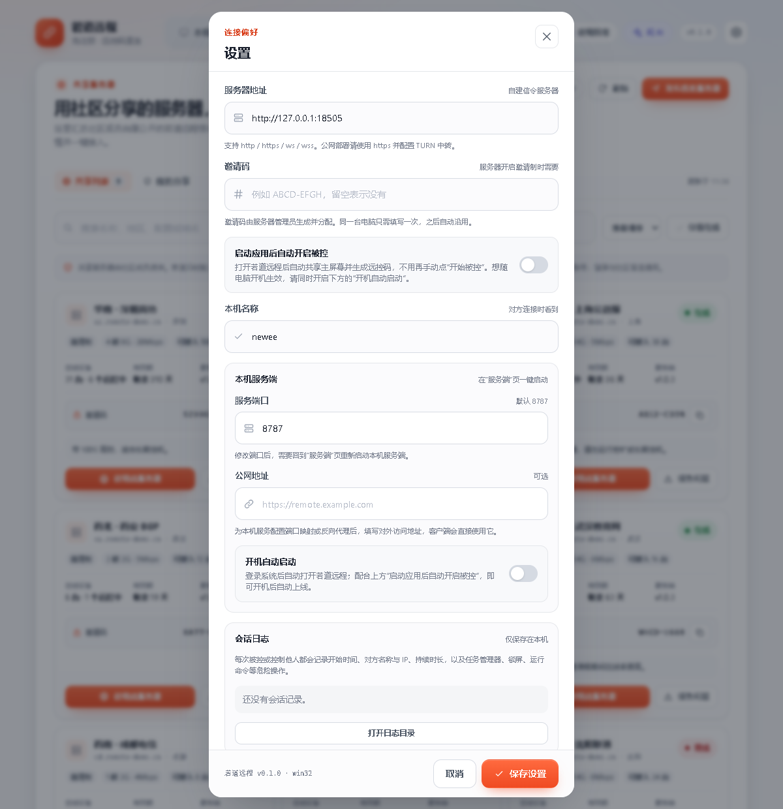

# 若道远程 · Ruodao Remote

**免注册的 Windows 桌面远控。** 被控端打开协助后得到 9 位远控码和 10 位访问密钥，主控端输入这两串号码即可连接。画面与键鼠输入通过 WebRTC 在两端之间端到端加密传输，服务器只负责信令、设备管理和 TURN 凭证。

[**简体中文**](README.md) · [English](README.en.md)

[](https://github.com/ruodaoai/ruodao-remote/releases/latest)
[](LICENSE)
[](#系统要求与已知限制)
[](https://github.com/ruodaoai/ruodao-remote/actions/workflows/ci.yml)

[**下载 Windows 版**](https://github.com/ruodaoai/ruodao-remote/releases/latest) ·
[**下载 macOS 版**](https://github.com/ruodaoai/ruodao-remote/releases/latest) ·
[服务端部署包](https://github.com/ruodaoai/ruodao-remote/releases/latest/download/ruodao-remote-server.zip) ·
[快速开始](docs/快速开始.md) ·
[服务端部署](docs/服务端部署.md) ·
[常见问题](docs/常见问题.md)

<p align="center">
  
</p>

## 为什么用它

| | |
| --- | --- |
| **不用注册** | 没有账号、没有邮箱验证，也不需要把设备绑定到云平台。两串号码就能建立一次远控。 |
| **端到端加密** | 画面与键鼠走 WebRTC，媒体与数据通道由 DTLS-SRTP 加密。信令服务器只能看到设备名、平台和连接元数据，看不到屏幕内容。 |
| **服务器自己掌握** | 信令、设备审批、邀请码和审计都在你自己的服务器上。局域网可直接用 Windows 本机服务端，公网可用客户端一键部署到 Linux 云服务器。 |
| **开箱即用的协作** | 会话中可文字聊天、按需同步剪贴板、切换画质与缩放、随时暂停输入；还支持把设备共享给同一服务器的成员，并由设备主人逐次批准。 |
| **共享服务器目录** | 「共享服务器」页汇总社区公开分享的信令服务器：按在线、延迟与有效期排序，一键把地址和邀请码写入本机设置；也支持发布自己的服务器、更新信息、下架与举报。 |
| **中英文界面** | 界面内置简体中文与英文，可在「设置 → 语言」随时切换；首次启动跟随系统语言。平台文案、使用指南、错误提示与公告均同步翻译。 |
| **遇到问题有兜底** | 内置分场景使用指南、基于当前状态的故障诊断，以及可选的 AI 助手（登录若道账号后使用，可附截图）。 |
| **若道社区** | 客户端内置「若道社区」页，按若道开源产品接入标准读取产品互动信息（评论数、点赞、版本、最近更新）与评论流；在客户端发的评论与 ruodao.com/open-source/ruodao-remote 完全同步，登录态与共享服务器共用。 |
| **可持续维护** | 客户端与 Linux 服务端都支持从若道发布接口检查更新，发布包强制校验 SHA-256。客户端自动下载并在退出时安装；服务端由部署脚本安装的系统定时器在空闲时自动更新，失败自动回滚。 |

## 界面预览

<table>
  <tr>
    <td width="50%"><br><sub><b>连接另一台电脑</b>：输入 9 位远控码和 10 位访问密钥，不需要账号。</sub></td>
    <td width="50%"><br><sub><b>共享服务器</b>：社区分享的信令服务器，登录后可见地址与邀请码，一键接入。</sub></td>
  </tr>
  <tr>
    <td width="50%"><br><sub><b>服务端管理</b>：在客户端里登录自建服务器，管理设备、邀请码、会话与操作记录。</sub></td>
    <td width="50%"><br><sub><b>内置指南</b>：分场景步骤、故障排查与 AI 助手，不用先读文档。</sub></td>
  </tr>
  <tr>
    <td colspan="2"><br><sub><b>设置</b>：服务器地址、邀请码、开机自启、剪贴板与自动更新，都在一个弹窗里。</sub></td>
  </tr>
</table>

## 3 分钟上手

### 1. 下载并安装

到 [Releases](https://github.com/ruodaoai/ruodao-remote/releases/latest) 下载 `RuodaoRemote-Setup-<版本>.exe`，双击安装。安装包当前未做代码签名，Windows SmartScreen 会提示「未知发布者」，选择「更多信息 → 仍要运行」即可；部分安全软件可能按启发式规则误报，请添加信任或只用安装版。

macOS 用户下载 `RuodaoRemote-<版本>-arm64.dmg`（Apple Silicon）或 `-x64.dmg`（Intel），打开后把「若道远程」拖入「应用程序」。DMG 未签名，首次启动需在 Finder 中右键图标选择「打开」。

### 2. 被控端：开始被控

打开客户端，停留在「本机被控」页，点击「开始被控」。页面会显示：

- **9 位远控码**，例如 `174 840 397`；
- **10 位访问密钥**，例如 `VJ9J5 Q2DXY`。

把这两串号码通过可信渠道发给对方。需要长期被控时，可以开启「启动后自动被控」和「开机自动启动」。

### 3. 主控端：输入号码连接

在另一台电脑打开同一个客户端，切到「控制远程设备」，填写相同的服务器地址，输入远控码与访问密钥，点击「连接远程设备」。被控端画面上会出现「正在被控制」，主控端即可看到画面并操作鼠标键盘。

> 默认服务器地址是 `http://127.0.0.1:8787`，只适合本机或同一台机器上的测试。要让两台电脑连接，需要先准备一个信令服务器（见下一节），或者在「共享服务器」页选一台社区分享的服务器。

## 共享服务器

「共享服务器」页是一个社区目录，数据来自若道云端接口，客户端只负责展示与跳转，不参与实际远控连接：

- **共享列表**：展示名称、地区、配置说明、在线状态、可接入设备数、服务端版本与有效期；支持搜索、按推荐/延迟/即将到期排序、只看在线。离线或过期的服务器不能接入。
- **登录后解锁**：未登录时只显示脱敏信息，并引导登录若道账号；登录态与「若道社区」共用。登录后才显示服务器地址与邀请码。
- **一键使用**：点击「使用此服务器」会把地址与邀请码写入本机设置并跳到「控制远程设备」，不需要手动抄写。
- **我的分享**：发布自己的服务器（名称、地址、地区、配置、可接入设备数、邀请码、补充说明），发布后可更新信息或下架。
- **举报**：对失效或违规的服务器提交报告，客户端会立即在本机隐藏该条目，等管理员复核。

> 共享服务器只是一种「公共信令服务器清单」。屏幕内容仍然只在两台设备之间传输，共享服务器的拥有者看不到你的画面。

## 自建服务端

远控链路不依赖若道账号。你只需要一台能被双方访问的服务器来转发信令。

### 方式一：在客户端里一键部署（推荐）

「服务端」页 →「一键部署新服务器」，填写 Linux 服务器的 IP、SSH 端口和账号（密码或私钥），选择接入模式，客户端会自动完成：

- 安装或复用 Node.js 与 Caddy；
- 写入独立的 systemd 服务与 Caddy 配置，不改动服务器上已有的网站；
- 可选安装 coturn，生成 TURN 密钥并写入配置；
- 安装系统级更新定时器：每小时检查服务端新版本，无远控会话时自动安装，失败自动回滚；
- 按实际使用的端口放行 ufw / firewalld；
- 部署完成后做健康检查，并把服务器地址、管理员密码写回本机。

适合 Ubuntu 22.04+ / Debian 12+（x86_64 或 arm64）。详细步骤和前置条件见 [服务端部署](docs/服务端部署.md)。

### 方式二：下载部署包手动安装

```bash
# 在 Linux 服务器上（root）
curl -LO https://github.com/ruodaoai/ruodao-remote/releases/latest/download/ruodao-remote-server.zip
unzip ruodao-remote-server.zip -d ruodao-remote-server
cd ruodao-remote-server
sudo bash install.sh
```

脚本会创建 `ruodao` 服务账号、安装到 `/opt/ruodao`、生成管理员密码并写入 `/etc/ruodao-remote.env`，然后启动 `ruodao-remote` systemd 服务。默认监听 `8787`，公网使用请在前面加 HTTPS 反向代理（Caddy / Nginx 配置见文档）。重复执行脚本即可升级服务端，不会清空设备、邀请码和审计数据。手动安装不会创建自动更新定时器；如需自动更新，可用客户端在同一台服务器上再执行一次一键部署补装。

## 安全模型

- **访问密钥不经过服务器**：密钥只在本机生成，服务器保存的是 16 字节随机盐 + PBKDF2-SHA256（210,000 次迭代）哈希，比对使用 `timingSafeEqual`。
- **传输加密**：画面与输入走 WebRTC，DTLS-SRTP 端到端加密；TURN 只转发已加密流量。
- **服务器只做信令**：能看到设备名、平台、IP 和会话元数据，但看不到画面、键鼠事件和明文密钥。
- **管理面**：管理员密码使用 scrypt 校验，登录态是带 HMAC 签名的 HttpOnly Cookie 或短期 Bearer Token；连续失败会按 IP 和全局双重锁定。
- **更新校验**：更新包必须来自 `ruodao.com` 或其子域名、必须提供 SHA-256，校验失败直接拒绝安装。

更完整的边界与已知限制见 [技术文档](docs/技术文档.md#7-安全模型与边界)，以及 [SECURITY.md](SECURITY.md)。

## 系统要求与已知限制

- 客户端：Windows 10 / 11 x64，或 macOS 12+（Intel / Apple Silicon）。macOS 版目前只作为主控端使用。
- 被控端的键鼠注入依赖 Win32 `SendInput`，目前只有 Windows 可用。
- 服务端：Linux + systemd（Ubuntu 22.04+ / Debian 12+ 最佳），或使用客户端内置的 Windows 本机服务端。
- 当前只采集主显示器；不支持多屏切换、`Ctrl+Alt+Del`、UAC 安全桌面和锁屏界面。
- 剪贴板同步只支持纯文本（单条上限 64 KB），默认关闭，需要双方开启。
- 安装包未签名；正式分发前建议使用代码签名证书。
- 远控密钥约 50 bit 熵，请通过可信渠道传递，并在使用后更换。

## 文档

| 中文 | English | 内容 |
| --- | --- | --- |
| [快速开始](docs/快速开始.md) | [Quick start](docs/en/quick-start.md) | 安装、被控、主控、会话协作与首次排查 |
| [服务端部署](docs/服务端部署.md) | [Server deployment](docs/en/server-deployment.md) | 一键部署、手动安装、HTTPS、TURN、管理后台 |
| [常见问题](docs/常见问题.md) | [FAQ](docs/en/faq.md) | SmartScreen、防火墙、NAT、连接失败、更新失败 |
| [更新与发布](docs/更新与发布.md) | [Updates & releases](docs/en/updates-and-releases.md) | 版本体系、更新接口约定、发布流程、自动更新配置 |
| [技术文档](docs/技术文档.md) | [Technical reference](docs/en/technical-reference.md) | 完整的环境变量、协议、安全边界与验证方法 |
| [贡献指南](CONTRIBUTING.md) | [Contributing](docs/en/contributing.md) | 开发环境、分支与提交规范、PR 要求 |

## 从源码构建

要求 Node.js 20+（开发环境使用 Node 24）。

```bash
# 服务端
cd server
npm install
npm run build
npm start                 # 0.0.0.0:8787

# 客户端（开发模式）
cd client
npm install
npm run dev

# 构建 Windows 安装包
cd client
npm run dist:win
```

验证：

```bash
cd server && npm test && npm run typecheck && npm run build
cd client && npm test && npm run typecheck && npm run build
```

`client` 的 `npm run smoke` 会启动两个真实 Electron 窗口，验证 WebRTC 连接、键鼠注入、会话聊天与剪贴板门控。该测试需要真实桌面会话，运行时会短暂移动本机鼠标。

## 项目结构

```
ruodao-remote/
├─ client/            Electron + React 桌面客户端（Windows x64）
│  ├─ electron/       主进程：信令、远控、共享设备、部署、更新、社区
│  ├─ src/            渲染层：页面、组件、hooks 与样式
│  └─ scripts/        构建、截图、更新清单与冒烟脚本
├─ server/            Node.js + TypeScript 信令服务器（含 /admin 管理后台）
├─ docs/              使用教程、部署文档、更新说明、截图（docs/en 为英文版）
├─ packaging/server/  服务端部署包脚本与 systemd 模板
└─ .github/           CI 与 Issue / PR 模板
```

## 版本与更新

- 版本号统一由根目录 `version.json` 管理，构建前会校验客户端与服务端版本一致；升版本执行 `node scripts/set-version.mjs 0.2.0`。
- 客户端打包版启动后会向若道更新源检查新版本，默认自动下载并在退出时安装；也可以点击顶部版本号手动检查和安装。
- 一键部署的 Linux 服务端会安装 `ruodao-remote-update.timer`：每小时检查，无远控会话时自动安装并重启，健康检查失败自动回滚。
- 发布流程、清单格式与全部更新变量见 [更新与发布](docs/更新与发布.md)。

## 反馈与贡献

- 遇到问题请先查看 [常见问题](docs/常见问题.md) 和客户端内的「使用指南」，仍然无法解决时在 [Issues](https://github.com/ruodaoai/ruodao-remote/issues) 反馈，并附上客户端版本、服务器地址类型（本机 / 公网）、错误提示和复现步骤。
- **请勿在 Issue 中粘贴远控码、访问密钥、管理员密码或 SSH 私钥。**
- 想改代码请先读 [贡献指南](CONTRIBUTING.md)：分支、提交规范、测试要求与 PR 检查项都在里面。

## 许可

本项目使用 [MIT License](LICENSE) 开源。你可以自由使用、修改和分发，但需保留版权声明与许可证文本；因使用本软件产生的风险由使用者自行承担。
