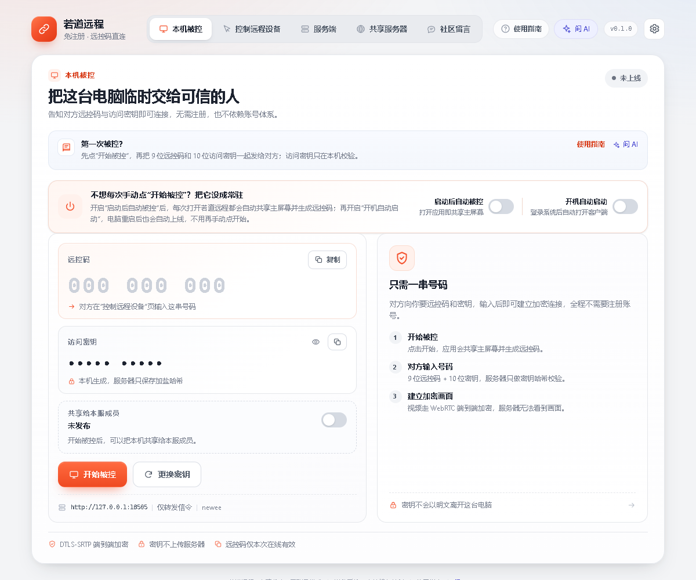
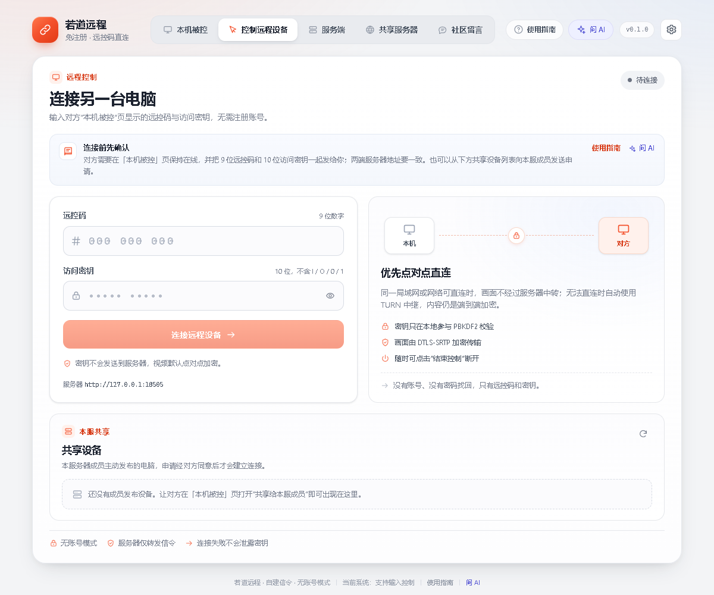
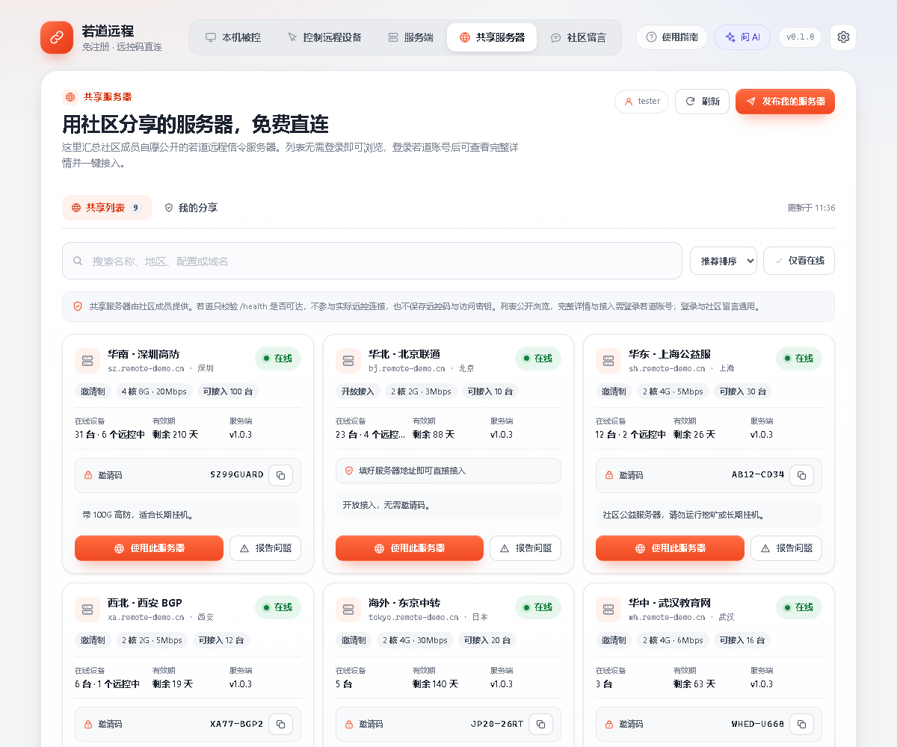

# Quick start

This guide walks through the first remote session: install → host → controller → in-session tools.

> If the two computers are not on the same LAN, or the default `127.0.0.1:8787` is unreachable, prepare a signaling server both sides can reach first — see [Server deployment](server-deployment.md).

[简体中文](../快速开始.md) · [**English**](quick-start.md)

## 1. Install the client

### Download

Get the latest `RuodaoRemote-Setup-<version>.exe` from [Releases](https://github.com/ruodaoai/ruodao-remote/releases/latest).

| File | Purpose |
| --- | --- |
| `RuodaoRemote-Setup-<version>.exe` | Windows installer, lets you choose a directory, creates desktop and Start Menu shortcuts |
| `ruodao-remote-server.zip` | Linux server bundle — ignore it if you only need remote control |
| `SHA256SUMS.txt` | Checksums for both packages |

### Install

1. Double-click the installer. It is not signed yet, so SmartScreen shows "Windows protected your PC" — click *More info* → *Run anyway*.
2. Pick an install directory (per-user install, no admin rights needed) and finish.
3. The first launch opens a three-step tour covering *Host*, *Control remote device* and *Share a server*.

Some antivirus products flag unsigned installers heuristically. Always download from this repository's Releases, add an exclusion, and prefer the installer over the portable build if it is blocked.

### Requirements

- Windows 10 / 11 x64;
- the host must allow screen capture and input injection — Windows may ask for firewall permission on the first session, allow at least *Private networks*;
- the controller only needs to reach the signaling server.

## 2. Host: hand over this computer

Open the client; it starts on the *Host* tab.

1. Click **Start hosting**.
2. The page shows two codes:
   - **Remote code** — 9 digits, e.g. `174 840 397`;
   - **Access key** — 10 characters, e.g. `VJ9J5 Q2DXY`.
3. Send both to the other person over a trusted channel (chat app, phone call, in person). The key is generated locally; the server only stores a salted hash.

### Unattended hosting

If this computer should always be reachable:

- **Auto-host on launch** — every launch shares the primary screen and generates a fresh code;
- **Launch at login** — starts the client after Windows sign-in.

With both enabled the machine comes online by itself after boot. Changing these switches does not start sharing immediately; they apply to the next launch.

### Rotate the key

**Rotate key** ends the current session immediately, invalidates the old key and issues a new code/key pair. Use it whenever you suspect the key leaked.

### Share with server members (optional)

Members of the same server do not get control automatically. On the *Host* tab enable **Share with server members** and add a note of up to 120 characters (free hours, purpose, etc.). A member's request must be approved or rejected by you within 60 seconds.

## 3. Controller: connect to another computer

Open the client on the other computer and switch to *Control remote device*.

1. Make sure the **server URL matches the host's** (shown bottom-right, editable in *Settings*).
2. Enter the 9-digit remote code and the 10-character access key.
3. Click **Connect remote device**.

Once connected:

- the host shows "Being controlled" and the controller sees the screen;
- mouse movement, clicks, wheel and keyboard are forwarded to the host;
- the host can pause input at any time or end the session.

### Connect through a shared server

If you do not run your own signaling server, open the *Shared servers* tab, pick a community server and click **Use this server** — the address and invite code are written into local settings and the app jumps to the controller page.

- Anonymous visitors only see redacted entries; signing in with a Ruodao account reveals the address and invite code (the session is shared with the *Community* tab).
- Search, sort by recommended / latency / expiring, and filter online-only. Offline or expired servers cannot be used.
- A shared server is only a publicly listed signaling server — your screen still flows between the two peers only.

### Connect to a shared device

If someone shared a device with the server members, the controller page lists it below (name, platform, note, busy state). Click **Request control** and wait for the owner's approval; the authorization token is single-use and expires in 60 seconds.

## 4. In-session tools

| Feature | Where | Notes |
| --- | --- | --- |
| Session chat | Chat bubble in the controller toolbar; top-right of the host session card | Two-way text chat with unread badges; kept in memory only and cleared on disconnect. |
| Clipboard sync | "Clipboard not allowed" on the host; clipboard button in the controller toolbar | Requires both sides to opt in, plain text only, 64 KB per item, off by default. |
| Quality presets | Controller toolbar dropdown | Smooth (~2.5 Mbps) / Balanced (~6 Mbps) / Sharp (~12 Mbps). |
| View zoom | "Fit / Fill / 1:1" in the controller toolbar | Fit shows everything; Fill crops edges; 1:1 uses real pixels with scrolling. |
| Pause input | "Pause input" on the host | Video keeps streaming, keyboard and mouse are dropped. |
| End control | Red "End control" on the controller | Disconnects and cleans up the session. |

The clipboard may contain passwords or one-time codes — only enable it in sessions you trust.

## 5. When something goes wrong

- **Cannot connect** — confirm both sides use exactly the same server URL (scheme, host, port) and that the host is online with no other session.
- **Black screen or stutter** — over the public internet, check whether the server has TURN configured; on a LAN check the firewall first.
- **Input does nothing** — the host may have paused input, or the focused window is a protected surface (UAC secure desktop, lock screen).
- **Not sure what to do** — open **Guide** in the header for scenario steps, check *Guide → Troubleshooting* for local diagnostics, or click *Ask AI* to get advice based on the current state.

More answers in the [FAQ](faq.md).
