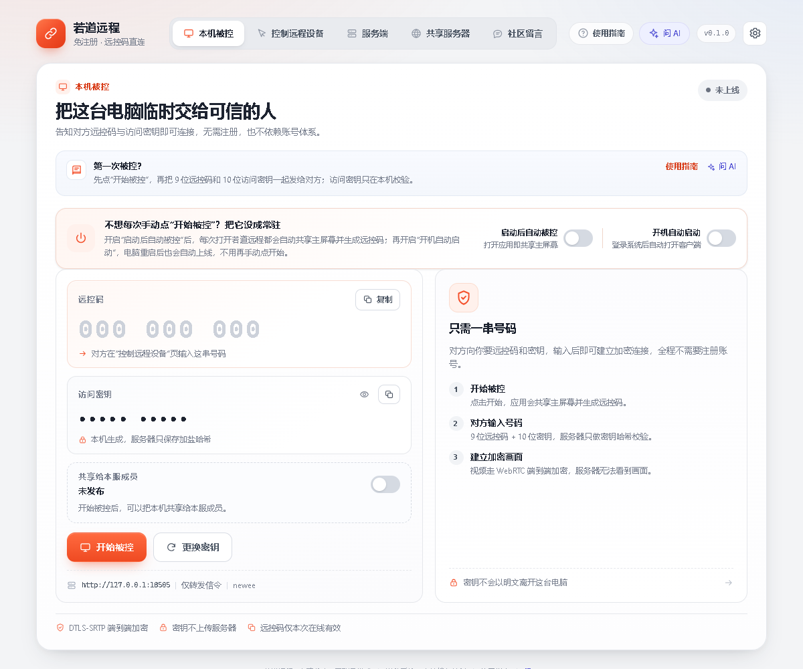
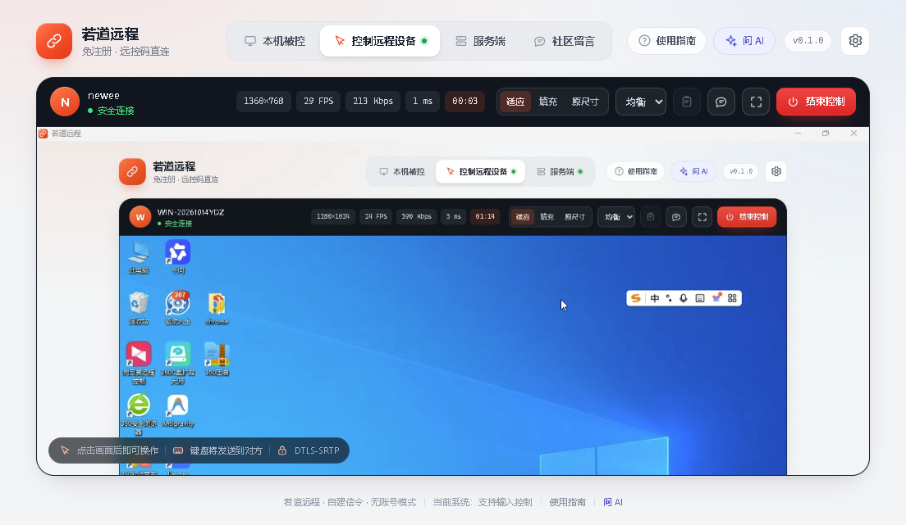

# 快速开始

本文按「安装 → 被控端 → 主控端 → 会话操作」的顺序，带你完成第一次远程连接。

> 如果两台电脑不在同一个局域网，或者默认的 `127.0.0.1:8787` 不可达，请先按 [服务端部署](服务端部署.md) 准备一个双方都能访问的信令服务器。

## 1. 安装客户端

### 下载

到 [Releases](https://github.com/ruodaoai/ruodao-remote/releases/latest) 下载最新的 `RuodaoRemote-Setup-<版本>.exe`。

| 文件 | 用途 |
| --- | --- |
| `RuodaoRemote-Setup-<版本>.exe` | Windows 安装版，可选安装目录，创建桌面和开始菜单快捷方式 |
| `ruodao-remote-server.zip` | Linux 服务端部署包，不需要远控时可忽略 |
| `SHA256SUMS.txt` | 安装包与服务端包的校验值 |

### 安装

1. 双击安装包。安装包目前未签名，Windows SmartScreen 会提示「Windows 已保护你的电脑」，点击「更多信息」→「仍要运行」。
2. 选择安装目录（默认按用户安装，不需要管理员权限），完成安装。
3. 首次启动会自动打开三步引导，介绍「本机被控」「控制远程设备」「分享服务」。

部分安全软件可能把未签名安装包按启发式规则误报。请从本仓库 Releases 下载，并在安全软件中添加信任；如果便携版被拦截，改用安装版。

### 系统要求

- Windows 10 / 11 x64；
- 被控端需要允许屏幕采集和键鼠注入，首次被控时 Windows 可能弹出防火墙授权，建议允许「专用网络」；
- 主控端只需要能访问信令服务器。

## 2. 被控端：把这台电脑交出去

打开客户端，默认就在「本机被控」页。

1. 点击橙色的「开始被控」。
2. 页面显示两串号码：
   - **远控码**：9 位数字，例如 `174 840 397`；
   - **访问密钥**：10 位字符，例如 `VJ9J5 Q2DXY`。
3. 把这两串号码通过可信渠道发给对方（聊天软件、口头告知都可以）。密钥只在本机生成，服务器只保存加盐哈希。

### 常驻被控

如果你希望这台电脑随时可以被连接：

- 打开「启动后自动被控」：之后每次打开客户端都会自动共享主屏幕并生成新的远控码；
- 打开「开机自动启动」：登录 Windows 后自动打开客户端。两个开关都打开，开机后就会自动上线。

这两个偏好只影响之后的启动，不会在你勾选的当下立刻开始共享。

### 更换密钥

点击「更换密钥」会立即关闭当前会话，旧密钥和旧会话同时失效，并生成一套新的远控码与密钥。怀疑密钥泄露时使用。

### 共享给本服成员（可选）

同一台服务器上的成员不会自动获得远控权。你可以在「本机被控」页打开「共享给本服成员」，填写最多 120 字的说明（例如空闲时段、用途）。成员提交远控申请后，你需要在 60 秒内点击「允许」或「拒绝」。

## 3. 主控端：连接另一台电脑

在另一台电脑打开客户端，切到「控制远程设备」。

1. 确认右下角显示的**服务器地址与被控端一致**。地址可在「设置」中修改。
2. 输入对方的 9 位远控码和 10 位访问密钥。
3. 点击「连接远程设备」。

连接成功后：

- 被控端顶部出现「正在被控制」，主控端看到对方屏幕；
- 主控端的鼠标移动、点击、滚轮和键盘输入会发送到被控端；
- 被控端可以随时点击「暂停操作」暂停输入，或直接结束会话。

### 通过共享设备连接

如果对方把设备共享给了本服成员，你会在「控制远程设备」页下方看到共享设备列表（只显示设备名、平台、说明和忙闲状态）。点击「申请远控」，等待对方允许后会自动建立连接。授权令牌一次性、60 秒内有效。

## 4. 会话中的操作

| 功能 | 入口 | 说明 |
| --- | --- | --- |
| 会话消息 | 主控端顶部气泡按钮；被控端会话卡片右上角 | 双向文字聊天，未读消息有角标；只保存在当前会话内存中，断开即清空。 |
| 剪贴板同步 | 被控端「剪贴板未允许」按钮；主控端顶部剪贴板按钮 | 双方都开启后才生效，只同步纯文本，单条上限 64 KB，默认关闭。 |
| 画质档位 | 主控端顶部下拉框 | 流畅（约 2.5 Mbps）/ 均衡（约 6 Mbps）/ 清晰（约 12 Mbps）。 |
| 视图缩放 | 主控端顶部「适应 / 填充 / 原尺寸」 | 适应完整显示；填充裁切边缘；原尺寸按真实像素显示并支持滚动。 |
| 暂停操作 | 被控端「暂停操作」 | 画面仍然实时可见，但键盘和鼠标不会发送。 |
| 结束控制 | 主控端红色「结束控制」 | 主动断开并清理会话。 |

剪贴板里可能有密码、验证码等敏感内容，请只在可信会话中开启。

## 5. 遇到问题

- **连不上**：先确认两端服务器地址完全一致（协议、域名、端口），再确认被控端处于「已上线」且没有其他会话。
- **画面黑屏 / 卡顿**：跨公网时检查服务器是否配置了 TURN；局域网可以先确认防火墙是否放行。
- **输入没反应**：被控端可能开启了「暂停操作」，或当前窗口是 UAC 安全桌面、锁屏界面等受保护界面。
- **不确定怎么操作**：点击顶部「使用指南」，按场景查看步骤；也可以在「使用指南 → 故障排查」里看基于当前状态的本地诊断，或点「问 AI」让 AI 结合状态给出建议。

更多问题见 [常见问题](常见问题.md)。
